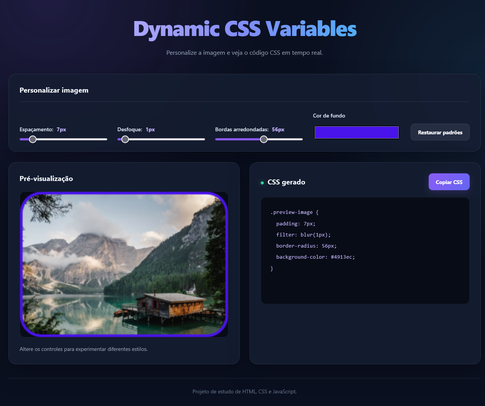

# Dynamic CSS Variables

A responsive web application that allows users to dynamically customize CSS variables and see the changes in real time. Built with HTML, CSS, and vanilla JavaScript, this project demonstrates how CSS custom properties can be controlled through interactive form elements.

## Features

- **Dynamic Spacing:** Adjust the spacing around the preview image.
- **Blur Effect:** Control the image blur intensity.
- **Border Radius:** Customize the rounding of the image corners.
- **Color Customization:** Change the background and accent color using a color picker.
- **Real-Time Preview:** See changes immediately without reloading the page.
- **Reset Settings:** Restore all controls to their default values.
- **Responsive Design:** Works on desktop and mobile devices.
- **No Dependencies:** Built with vanilla JavaScript and standard web technologies.

## Technologies Used

- HTML5
- CSS3
- JavaScript (Vanilla JS)
- CSS Custom Properties
- DOM Manipulation
- Event Listeners

## Project Structure

```text
Dynamic-CSS-Variables/
├── index.html
├── css/
│   └── styles.css
├── js/
│   └── script.js
└── README.md
```

## Getting Started

### Prerequisites

You only need a modern web browser to run this project.

### Installation

1. Clone the repository:

   ```bash
   git clone https://github.com/YOUR-USERNAME/Dynamic-CSS-Variables.git
   ```

2. Navigate to the project directory:

   ```bash
   cd Dynamic-CSS-Variables
   ```

3. Open `index.html` in your browser.

No additional dependencies or build tools are required.

## How to Use

1. Open the application in your browser.
2. Adjust the **Spacing** slider to change the space around the image.
3. Use the **Blur** slider to control the blur effect.
4. Adjust the **Border Radius** slider to round the image corners.
5. Select a new color using the color picker.
6. Click **Reset Settings** to restore the default values.

## How It Works

The application uses CSS custom properties to control visual styles dynamically.

For example, CSS variables are declared in the `:root` selector:

```css
:root {
    --base-color: #38bdf8;
    --spacing: 10px;
    --blur: 0px;
    --radius: 12px;
}
```

JavaScript updates these properties with the `style.setProperty()` method:

```javascript
document.documentElement.style.setProperty("--blur", "5px");
```

Whenever a variable changes, the browser automatically updates the elements that use it.

## Learning Objectives

This project helps practice:

- Declaring and using CSS custom properties.
- Manipulating CSS styles with JavaScript.
- Handling user input with event listeners.
- Updating interface elements in real time.
- Working with range sliders and color inputs.
- Creating responsive layouts with CSS Grid.
- Organizing a project into separate HTML, CSS, and JavaScript files.

## Future Improvements

- Add more customizable CSS properties.
- Allow users to copy generated CSS variables.
- Add a light and dark theme switcher.
- Save user preferences using local storage.
- Provide multiple preview elements.
- Add a button to export the current settings as CSS code.

## Screenshot



## Author

**Lucas Neves**

- GitHub: [@Taunt-byte](https://github.com/Taunt-byte)

## License

This project was created for educational and portfolio purposes. Add a `LICENSE` file if you want to specify the terms for using, modifying, and distributing the project.